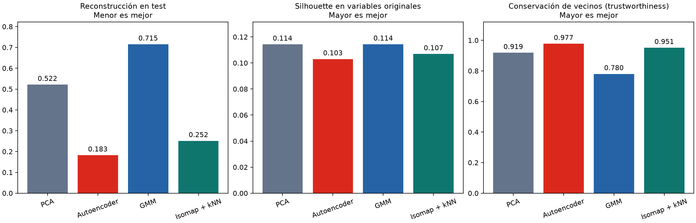

# Modelo NBA y perfiles de consumo

El motor elige campañas y un canal por cliente, respeta las reglas y los cupos y maximiza el valor esperado con los scores suministrados por el reto. Los perfiles exploratorios comparan un autoencoder, PCA, mezclas gaussianas e Isomap. No se entrena una nueva propensión de compra.

## Ejecutar

Desde la raíz del repositorio, con Python 3.11:

```powershell
python -m pip install -r modelo/requirements.txt
python -m unittest discover -s modelo/tests -v
python -m modelo.ejecutar --tarea todo --fecha 2026-11-05
python -m modelo.comparar
python -m modelo.exportar_evaluacion
```

`--tarea nba` ejecuta solo la asignación; `--tarea perfiles` entrena solo el autoencoder y PCA. `comparar` requiere los artefactos de perfiles. Las ejecuciones completas, pesos, perfiles por cliente y parrillas se guardan en `resultados/`, que está excluido de Git. `evaluacion/` conserva únicamente métricas, una tabla y un gráfico para revisar esta ejecución. No se incluyen notebooks.

La ejecución usa CPU y cuatro hilos. Los programas no abren terminales ni servidores. La fecha es explícita para reproducir la vigencia de las campañas.

## Resultado NBA

Ejecución sobre los 100.000 registros de [`../datos/clientes.csv`](../datos/clientes.csv), fecha de evaluación 2026-11-05:

| Métrica | Baseline | Optimización global |
| --- | ---: | ---: |
| Valor esperado | 10.241,5933 | 10.940,0025 |
| Clientes con acción | 55.393 | 60.422 |
| Productos asignados | 70.444 | 76.841 |
| Cumplimiento de jerarquía entre asignados | 99,677 % | 99,836 % |
| Violaciones | 0 | 0 |

La optimización mejora el valor esperado calculado en **698,4091 (+6,819 %)** respecto de nuestra baseline. Los cinco ejemplos oficiales coinciden en estado, canal y campañas al consultar la corrida completa. Esos ejemplos incluyen el efecto de los cupos de los otros clientes; ejecutar solo cinco clientes no reproduce la corrida de 100.000.

El PDF publica 10.241,5 y 70.443 productos. Nuestra baseline produce una pequeña diferencia y usa desempates deterministas por ID; no se afirma reproducción exacta de esa cifra publicada. Los resultados numéricos completos están en [evaluacion/nba.json](evaluacion/nba.json).

`nba.py` construye el mejor conjunto factible de productos para cada combinación cliente/canal y resuelve la asignación global con `scipy.optimize.linprog`/HiGHS. El problema de capacidades tiene soluciones enteras; se comprueba la integralidad obtenida y no se redondean asignaciones fraccionarias silenciosamente. Un auditor por filas revisa las salidas contra los datos y las reglas antes de exportarlas.

## Configuración

- `config/campanas.json`: productos, scores, valor, canales, vigencia y activación.
- `config/reglas.json`: reglas activas y condiciones por columnas; permite reglas nuevas sin cambiar Python. Operadores: `==`, `!=`, `<`, `<=`, `>`, `>=`, `en`, `no_en`, `contiene` y composiciones `todas`/`alguna`. `contiene` compara tokens separados por `|`; `$producto` referencia el producto de la campaña. La acción implementada es `excluir`.
- `config/parametros.json`: umbrales, capacidades, política de contacto, jerarquía y objetivo.
- `config/perfiles.json`: variables, preprocesamiento, red, particiones y entrenamiento.
- `config/comparacion.json`: candidatos gaussianos, tamaño del grafo Isomap y validación.

La baseline usa la prioridad ponderada configurada para ordenar clientes y productos, y selecciona canales por `score_canal` o `orden_preferencia`. En el optimizador, `optimizacion.objetivo: "valor_esperado"` maximiza `score_producto × score_canal × valor_negocio`; `"prioridad"` usa los pesos de priorización. Los pesos no alteran el objetivo puro de valor esperado. `jerarquia_estricta` obliga a conservar el producto de mayor prioridad elegible dentro de cada propuesta de canal. La jerarquía también se reporta como indicador independiente. El optimizador de valor no impone el orden de preferencia del canal de la baseline.

El contrato de salida admite un canal y hasta dos campañas por cliente. Se rechazan configuraciones que excedan esos límites. Los CSV originales del kit están en `kit_original/`; `importar_kit.py` los convierte inicialmente a JSON y se niega a sobrescribir una configuración existente. Las reglas del CSV y del PDF tienen numeración diferente: el campo `control` permite agrupar la auditoría en los controles R01–R16 del PDF.

## Validación de autoencoder, gaussianos e Isomap

Se conservan exactamente **70.000 clientes de entrenamiento, 15.000 de validación y 15.000 de test**, con semilla 42. Las estadísticas de imputación y estandarización se aprenden solo en entrenamiento. El plan `999` se trata como ilimitado, con indicador separado; los ARPU reciben `log1p`. No se usan IDs, scores de oferta, riesgo ni historial de contacto como entradas del perfil.

| Método | MSE test ↓ | Reducción MSE frente a PCA | Silhouette original ↑ | Trustworthiness ↑ |
| --- | ---: | ---: | ---: | ---: |
| PCA, 5 dimensiones | 0,521525 | referencia | 0,11430 | 0,91865 |
| Autoencoder, 5 dimensiones | **0,182633** | **64,98 %** | 0,10303 | **0,97744** |
| Mezcla gaussiana, 5 componentes | 0,715131 | −37,12 % | 0,11435 | 0,78032 |
| Isomap, 5 dimensiones + decoder kNN | 0,251570 | 51,76 % | 0,10689 | 0,95138 |

**El autoencoder conserva el menor error de reconstrucción.** Isomap mejora frente a PCA, pero tiene 37,75 % más error que el autoencoder. GMM tiene 291,57 % más error que el autoencoder usando reconstrucción por medias de componentes. Los coeficientes silhouette son bajos para todos: no se observa una separación fuerte de grupos en las variables originales. La diferencia entre GMM y PCA en silhouette es apenas 0,00005 y no justifica afirmar una mejora material.

La tabla completa, candidatos y límites están en [evaluacion/comparacion.json](evaluacion/comparacion.json) y [comparacion.csv](evaluacion/comparacion.csv).



Protocolo y alcance:

- Autoencoder `20 → 32 → 16 → 5 → 16 → 32 → 20`, MSE, Adam, hasta 50 épocas, selección de pesos por validación. PCA conserva cinco componentes y ajusta solo en train. La comparación reutiliza sus pesos, proyección y particiones; comprueba que los datos reproducen sus latentes y errores guardados.
- GMM prueba covarianzas diagonal y completa, cinco componentes y dos inicializaciones; ambas convergen. Se elige covarianza completa por máxima log-verosimilitud de validación. Test tiene log-verosimilitud media 0,37368. Esa cifra solo compara densidades gaussianas con la misma codificación: no equivale a MSE ni a exactitud de clasificación. Las variables binarias y categóricas codificadas limitan la interpretación de una densidad gaussiana continua.
- La reconstrucción de GMM es `probabilidades × medias`. Sus cinco probabilidades suman uno y tienen cuatro grados de libertad; no es un decoder con la misma capacidad que el autoencoder. No se concluye que toda variante gaussiana sea inferior: se evalúa este pipeline de cinco componentes.
- Isomap ajusta un grafo en 3.000 puntos tomados exclusivamente de train y transforma el resto por lotes. Prueba 15/30 vecinos del grafo y 5/15/30 del decoder. Ganan 30 y 5 por MSE de validación. El decoder kNN se ajusta con los 70.000 clientes train. No hubo avisos de grafo desconectado. Isomap no ofrece `inverse_transform`; su `reconstruction_error()` mide otro coste geométrico, así que no se mezcla con el MSE de las variables. Aquí se compara el pipeline **Isomap + kNN**.
- PCA, autoencoder e Isomap se segmentan con KMeans en sus representaciones; GMM usa el componente más probable. Se comparan cinco grupos. Silhouette, Davies–Bouldin y Calinski–Harabasz se calculan sobre las mismas 2.000 observaciones test en el espacio original estandarizado. El silhouette latente de la ejecución original del autoencoder no se compara directamente con estos valores.
- Trustworthiness utiliza los mismos 1.000 clientes test y diez vecinos. El IC bootstrap pareado, con 500 repeticiones por cliente, estima diferencias de MSE frente al autoencoder. Es evidencia sobre este conjunto sintético, no sobre ventas reales.
- Los tiempos de los modelos reutilizados no representan nuevos entrenamientos. Las métricas guardan tiempos de los candidatos y del pipeline elegido; no se comparan como un benchmark de entrenamiento con presupuestos idénticos.

Los segmentos son exploratorios. Los datos no tienen compras observadas, respuesta a campañas, emociones ni horas de respuesta. Estas pruebas no demuestran mejora de conversión y no cambian los scores oficiales ni las asignaciones del motor NBA.

## Propuestas por sector

[`experimentos/`](experimentos/README.md) agrupa a los clientes de Bogotá por comportamiento (consumo, streaming, uso digital, Hogar) y por estrato, hace un sondeo de qué consume cada estrato, genera varias propuestas de mensaje por campaña adaptadas a cada sector y las reparte por probabilidades con un bandido bayesiano, al estilo de las pruebas A/B de miniaturas. Se apoya en la parrilla del motor NBA y no cambia sus scores ni sus asignaciones. Su rendimiento se mide en un simulador con supuestos declarados, porque el CSV no trae respuestas reales: ver sus límites en el README del módulo. Los resultados se muestran en una sección nueva del [mapa](../mapa/README.md).

```powershell
python -m unittest modelo.tests.test_experimentos -v
python -m modelo.experimentos
```

## HNSW

[HNSW](https://arxiv.org/abs/1603.09320) es un índice de vecinos aproximados organizado como grafo por capas. Puede usarse sobre los perfiles originales o sus representaciones para recuperar clientes similares. Como propuesta de arquitectura, podría acelerar la etapa de vecinos de Isomap; no elimina el cálculo posterior de distancias geodésicas ni su proyección. La implementación [hnswlib](https://github.com/nmslib/hnswlib) expone `M`, `ef_construction` y `ef` para ajustar memoria y el compromiso entre velocidad y recall.

**Se investigó, pero no se ejecutó ni se incorporó HNSW en los resultados anteriores.** La prueba de Isomap usa vecinos exactos. Para validar HNSW habría que construir el índice solo en train, ajustar `ef` en validación y medir `recall@k`, latencia, tiempo de construcción y memoria frente a búsqueda exacta con las mismas consultas test. HNSW optimiza búsqueda; no estima conversión ni sustituye la optimización NBA.

## Referencias

- Reto, diccionario, presentación y ZIP oficial en [`../docs/reto/`](../docs/reto/README.md). El CSV principal está en [`../datos/clientes.csv`](../datos/clientes.csv); `rutas.py` centraliza las ubicaciones del modelo.
- Notebooks de Aprendizaje Profundo: optimización y regularización, PyTorch y autoencoders. Se adaptan separación train/validación/test, escalado en train, referencia PCA y reconstrucción. Los archivos externos y sus datasets no se copian al repositorio.
- Documentación primaria: [GaussianMixture](https://scikit-learn.org/stable/modules/generated/sklearn.mixture.GaussianMixture.html), [Isomap](https://scikit-learn.org/stable/modules/generated/sklearn.manifold.Isomap.html), [trustworthiness](https://scikit-learn.org/stable/modules/generated/sklearn.manifold.trustworthiness.html), [parámetros de HNSW](https://github.com/nmslib/hnswlib/blob/master/ALGO_PARAMS.md).
