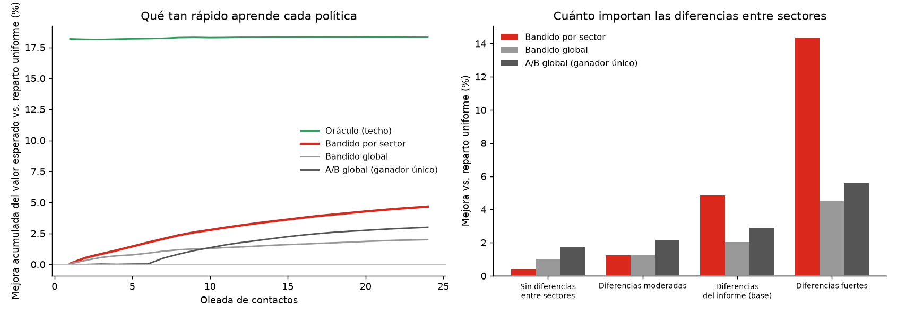

# Clusters por comportamiento y propuestas por sector

Idea: YouTube prueba varias miniaturas, aprende cuál funciona y reparte el tráfico hacia la mejor. Aquí se hace lo
mismo con los mensajes de cada campaña, pero **por cluster y estrato**, con probabilidades y para **varias
campañas a la vez**. Todo se apoya en la parrilla del motor NBA, así que respeta sus reglas y cupos.

```powershell
python -m pip install -r modelo/requirements.txt
python -m unittest modelo.tests.test_experimentos -v           # 23 pruebas, ~3 s
python -m modelo.experimentos.comportamiento                   # ~2 s: sondeo de comportamiento por estrato
python -m modelo.experimentos                                  # ~2,5 min: NBA + clusters + simulación + 3 restricciones
python -m modelo.experimentos --sin-restricciones              # ~45 s, sin volver a correr el motor por cada restricción
python -m modelo.experimentos.foco                             # ~3 min: motor enfocado en los clusters más probables
python mapa/generar_mapa.py --reutilizar-html mapa/mapa-estratos-bogota.html   # mapa con todo lo anterior
```

## 1. Sondeo por estrato: qué consume y cómo se comporta cada estrato

El CSV **no trae «flujo»** (compras, uso mes a mes, respuestas a campañas ni horarios), pero sí variables de consumo
y comportamiento por cliente. `comportamiento.py` las resume por estrato en Bogotá (28.190 clientes) y mide cuáles
distinguen de verdad a un estrato de otro. Resultado: **solo 6 de 18 variables cambian con el estrato, y todas
suben parejo con él**:

| | Estrato 1 | Estrato 3 | Estrato 6 |
| --- | ---: | ---: | ---: |
| Tienen servicio Hogar | 25,3 % | 36,4 % | 55,7 % |
| Tienen Netflix | 39,6 % | 50,5 % | 72,1 % |
| Tienen Amazon Prime | 18,7 % | 28,0 % | 47,9 % |
| Plataformas de streaming por cliente | 0,76 | 0,98 | 1,41 |
| Usan banca digital | 33,0 % | 50,2 % | 72,9 % |
| Compran en línea | 36,8 % | 50,7 % | 70,0 % |

Todo lo demás es **plano entre estratos**: consumo del plan de datos, tamaño del plan, ARPU, edad, antigüedad,
gama y edad del equipo, riesgo de fuga, mora y quejas. El mapa muestra la tabla completa (rojo = sobre el promedio,
azul = bajo).

## 2. Clusters por comportamiento

Un **cluster** es un perfil de comportamiento (PCA + KMeans, 5 perfiles) y un **sector** es cluster × estrato. Los
perfiles se forman solo con consumo de datos, streaming (Netflix, Amazon, Win), uso digital (redes, banca,
compras) y Hogar; no usan tipo de línea, ARPU, gama ni estrato. En Bogotá salen 28 sectores. Ejemplos de nombres:
«Muy digitales · compra en línea · usa banca digital», «Con streaming · con Hogar · con Amazon Prime», «Sin
streaming · sin Hogar · sin Win».

Son casi independientes del estrato (información mutua 0,02), **pero su composición cambia con él**: el perfil «sin
streaming ni Hogar» es el 43 % del estrato 1 y el 11 % del 6, mientras que los perfiles «muy digitales» y «con
streaming y Hogar» suman el 74 % del estrato 6. Eso es lo que permite hacer campañas distintas por zona.

`sectores.perfil` en `config.json` permite volver a los perfiles por contrato (`contrato`, las variables de
`config/perfiles.json`: tipo de línea, ARPU, gama), que separan sobre todo prepago de postpago y no distinguen
estratos. Los clusters son descriptivos (silhouette bajo), no un modelo validado, y no tienen ubicación propia:
**un cluster vive en todos los estratos**. En el mapa solo se puede resaltar el estrato de su sector, nunca un barrio.

## 3. Viabilidad: qué campaña conviene a cada sector y qué reglas la bloquean

`viabilidad.py` responde «¿qué campaña es más viable para qué sector, y por qué no otra?» con datos del propio motor
NBA. Para cada sector × campaña cuenta los clientes, cuántos sobreviven a cada regla, cuántos tienen un canal
habilitado y cuánto valor esperado les asigna la parrilla (con cupos limitados). Una celda sin clientes viables queda
**bloqueada** y nombra la regla responsable (ante un empate, la regla de negocio antes que el umbral de score). En el
mapa (`mapa/`, pestaña **Viabilidad**):

- Matriz sector × campaña con candados, ◐ cuando más de la mitad del sector queda fuera, y un embudo por celda con
  lo que cada regla deja fuera *por sí sola*; reglas vigentes con cuántos clientes deja fuera cada una.
- **Mapa de calor** (modo por defecto): rojo más intenso y opaco donde la campaña es más viable, transparente donde
  no o donde está bloqueada. Escala ampliada entre el estrato menos y el más viable; el ranking de la leyenda trae los
  valores reales.
- **Clusters más probables**: ranking, grilla cluster × estrato y, al elegir uno, el mapa resalta el estrato donde vive.
- **Restricción de negocio a probar** (`restricciones_hipoteticas`): cada una vuelve a correr el motor NBA con una
  regla nueva, para ver el costo real y cómo se reasignan los cupos.

| Restricción probada | Celdas bloqueadas | Valor esperado (país) |
| --- | ---: | ---: |
| Ninguna (reglas actuales) | 0 | 10.940,0 |
| No ofrecer streaming a estrato 1 | 5 | 10.463,0 (−4,4 %) |
| No ofrecer terminales a clientes prepago | 0 (ningún cluster es solo prepago) | 10.159,1 (−7,1 %) |
| No ofrecer Hogar a estratos 1 y 2 | 10 | 10.457,1 (−4,4 %) |

Una restricción nueva no requiere código: es una regla (atributo, operador, valor, alcance) en
`modelo/config/reglas.json` o, para probarla antes, en `restricciones_hipoteticas`. No hay una campaña de Disney+ en
el kit; el ejemplo de streaming usa Upgrade OTT (Netflix, Amazon Prime, Win).

## 4. Si se corre el modelo enfocado en los clusters más probables

`foco.py` toma los clusters con más valor esperado por cliente (sin el sector residual de perfiles pequeños) y mide
tres lecturas de «enfocar» el motor NBA:

1. **Cupo aislado**: el motor corre solo con esos clientes y todo el cupo de canales es para ellos. Es un techo, no
   alcanzable (nadie más recibiría nada).
2. **Mismo presupuesto, con prioridad**: población completa y cupos iguales, pero la utilidad de esos clientes pesa N
   veces más. Lo que sube en el foco se lo quita a otros clientes.
3. **Propuestas de mensaje**: la mejora del reparto por sector medida en el simulador (supuestos declarados).

| Foco | Clientes | Techo (todo el cupo) | Prioridad ×3 (mismo cupo): foco / total país | Propuestas (simulado) |
| --- | ---: | ---: | ---: | ---: |
| El cluster más probable | 419 | +2,4 % | +2,1 % / −1,0 | +4,6 % |
| Los 5 más probables | 3.558 | +3,6 % | +3,0 % / −9,8 | +4,9 % |
| Los 10 más probables | 10.858 | +4,4 % | +3,6 % / −33,3 | +6,0 % |

**Enfocar apenas sube el valor** ni siquiera con todo el cupo (+2 % a +4 %): el óptimo global ya atiende primero a los
clusters más valiosos, así que no queda mucho por ganar reasignando. Con el mismo presupuesto, lo que sube en el foco
baja en el resto y el total país no mejora (−1 a −33 de 10.940). Lo que sí mueve es la elección del mensaje, y eso es
una simulación.

## 5. Propuestas de mensaje y reparto por probabilidades

- **Propuestas** (`propuestas.py` + `config.json`): 4 por campaña (ahorro, novedad, familia, entretenimiento), con el
  texto adaptado al sector mediante un gancho que sale de su rasgo más marcado; el SMS respeta 160 caracteres. Una
  campaña nueva usa una plantilla genérica: se agrega por configuración.
- **Reparto** (`bandido.py`): bandido bayesiano (Thompson) por sector × campaña. Mide el *lift* de cada propuesta contra
  el score del reto (P(compra) = score producto × score canal × lift), lo que evita confundir una propuesta buena con
  un sector que ya compraba más. Un sector pequeño toma prestada información de toda la campaña y se separa de ella a
  medida que acumula evidencia. Cada oleada reparte las propuestas según la probabilidad de ser la mejor.
- **Rendimiento** (`simulador.py`): oleadas de contactos sobre la parrilla, con cinco políticas comparadas con las
  mismas oleadas y los mismos números aleatorios.

| Política | Qué es |
| --- | --- |
| `uniforme` | A/B sin aprendizaje: reparte las propuestas por igual (línea de comparación) |
| `ganador_global` | A/B tradicional: explora el 25 % del tiempo y fija un único ganador por campaña |
| `bandido_global` | Bandido por campaña, sin sectores (aísla cuánto aporta sectorizar) |
| `bandido_sector` | **El propuesto** |
| `oraculo` | Conoce la verdad: es el techo, no una política alcanzable |

Resultado (Bogotá, 21.774 contactos, 24 oleadas, 20 repeticiones), mejora del valor esperado frente a repartir por
igual:

| Política | Mejora media | Rango 5–95 % |
| --- | ---: | ---: |
| Ganador global (A/B) | +2,99 % | −0,21 a +5,60 |
| Bandido global | +1,99 % | +0,43 a +3,78 |
| **Bandido por sector** | **+4,66 %** | **+3,50 a +5,90** |
| Oráculo (techo) | +18,31 % | +17,10 a +19,49 |

Captura cerca de una cuarta parte de lo que daría conocer la verdad e identifica la mejor propuesta para el 61 % de los
contactos. Es más estable que el A/B de ganador único (peor caso +3,5 %, frente a −0,2 %).



## Lo que esto NO demuestra

- **No hay respuestas reales.** El CSV no tiene compras ni clics, así que el efecto verdadero de una propuesta no se
  puede medir. El simulador define un mundo oculto con supuestos declarados en `config.json` (`verdad_simulada` y
  `afinidad` de cada variante): cada propuesta mejora o empeora el score según la afinidad entre su enfoque y los
  rasgos del sector (p. ej. «novedad» rinde más con banca digital y compras en línea; «entretenimiento» con
  streaming). **Son supuestos, no hallazgos**, y se ajustaron a los rasgos que definen los clusters actuales. Con
  respuestas reales, `bandido.py` aprende de ellas sin cambios.
- **Sectorizar no siempre paga.** Depende de cuánto se diferencien los sectores:

| Diferencias entre sectores | Bandido por sector | A/B global | Oráculo |
| --- | ---: | ---: | ---: |
| Ninguna | +0,38 % | **+1,72 %** | +4,06 % |
| Moderadas | +1,23 % | **+2,14 %** | +9,68 % |
| Las del informe (base) | **+4,89 %** | +2,90 % | +18,38 % |
| Fuertes | **+14,36 %** | +5,59 % | +32,84 % |

  El equilibrio está entre diferencias moderadas y las del informe. Por eso conviene validar con una prueba real antes
  de sectorizar a fondo.
- **Los sectores pequeños aprenden despacio.** Varios tienen decenas de contactos por campaña: la probabilidad de ser
  la mejor queda en 35–50 % y el intervalo del *lift* es ancho. El sistema lo muestra; una recomendación con 40 % no es
  una certeza.
- La fuerza del prior (5) y el piso de exploración (5 %) se fijaron de antemano; esos números también salen del mundo
  simulado. El *lift* usa una aproximación de Poisson, adecuada para comparar propuestas, no para predecir
  conversiones absolutas.

## Para la consola del Grupo 5 (sin mapa)

`exportar_app.py` corre todo esto sobre los **100.000 clientes** (no solo Bogotá) y escribe en la consola
(`hackatonv.2`): `app/static/datos/clusters.json` (5 clusters, 30 segmentos, publicidad por cluster y rendimiento) y
`datos/clusters.csv` (cluster de cada cliente). La consola desglosa en vivo, por cluster, lo que hace su motor con cada
simulación; ver su README.

```powershell
python -m modelo.experimentos.exportar_app --app C:\ruta\a\hackatonv.2     # ~1 min
```

Con los 100.000 clientes hay más contactos por segmento y el reparto por cluster rinde más que en Bogotá sola: +7,1 %
frente a +3,9 % del A/B de ganador único, con el mismo equilibrio (el A/B global gana si los clusters responden casi igual).

## Cómo probarlo con campañas reales

1. Elegir sectores y campañas y publicar las 4 propuestas con el reparto que sugiere `propuestas_por_sector.csv`.
2. Registrar por contacto: sector, campaña, propuesta, canal y respuesta.
3. Alimentar `compras` y `esperadas` de `BandidoSector` y repartir la siguiente oleada con las nuevas probabilidades.
4. Comparar contra un grupo de control con reparto uniforme para medir la mejora real.

## Archivos

- `config.json`: perfil de los clusters, parámetros del experimento, supuestos del simulador, foco, restricciones
  hipotéticas, variantes, ganchos y plantillas.
- `comportamiento.py`, `sectores.py`, `propuestas.py`, `bandido.py`, `simulador.py`, `viabilidad.py`, `foco.py`, `exportar_app.py`, `ejecutar.py`.
- Salidas versionadas en `../evaluacion/`: `experimentos.json` (lo lee el mapa), `comportamiento.json`, `foco.json`,
  `propuestas_por_sector.csv`, `experimentos_rendimiento.png`.
